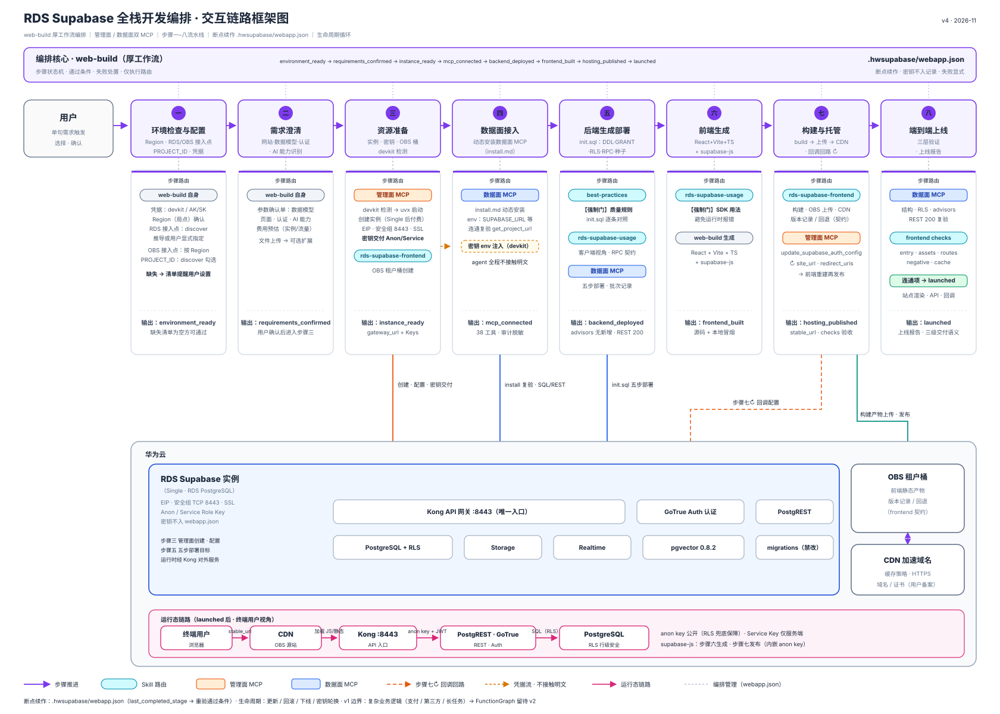

# rds-supabase-web-build · RDS Supabase 全栈开发编排技能

用户以单句自然语言需求（如"创建一个网站"）触发，AI Agent 完成 RDS Supabase 上从需求到上线的完整链路：后端 init.sql（DDL/GRANT/RLS/RPC）生成部署、前端代码生成、OBS+CDN 全托管、端到端上线验收与生命周期管理（更新/回滚/下线/密钥轮换）。本技能是厚工作流编排者——步骤状态机、通过条件、失败处置、断点续作；各环节深度内容由五个专项技能承载，仅执行路由，不复制内容。

**AI Agent 的执行逻辑见 [SKILL.md](SKILL.md)**；本文面向人类读者：总览、安装与来源。

## 整体交互链路框架图



五区带自上而下：编排条（web-build + webapp.json 状态机）→ 步骤一–八流水线 → 步骤路由卡（技能/双 MCP）→ 云资源底座（RDS Supabase 实例 + OBS/CDN）→ 终端用户运行态链路。

## 一句话安装

安装阶段**只安装 rds-supabase 技能包**（全部技能，从本 GitHub 源码仓克隆/添加）——不安装、不配置任何 MCP 与凭据。把下面这句话直接发给你的 AI Agent 即可：

> 从 https://github.com/huaweicloud/rds-supabase-fullstack 克隆仓库，把 `skills/huaweicloud-supabase/` 下所有技能完整安装进项目级技能目录，装完汇报已装技能清单与一句话建站触发语。

简短版本（本技能已在 Agent 上下文时）：**"按本技能 README 的「一句话安装」指引，把 rds-supabase 技能包（全部技能）完整安装到项目级技能目录，装完汇报安装结果。"**

Agent 执行要点：

1. **技能包（安装阶段的全部内容）**：`npx skills add huaweicloud/rds-supabase-fullstack`，或把 `skills/huaweicloud-supabase/` 下所有技能完整安装到项目技能目录。**安装位置强约束**：只装**项目级**技能目录——CodeArts `<项目根>/.codeartsdoer/skills/`、opencode `<项目根>/.opencode/skills/`、Claude Code `<项目根>/.claude/skills/`；**禁止系统内置/系统级目录与一切个人级目录**（`~/.codeartsdoer/skills`、`~/.config/opencode/skills/`、`~/.claude/skills/` 等，注意 CodeArts 两级目录同名不同根）——技能版本随项目走，不污染其他项目与本机全局；CLI 默认落位为个人级时弃用其结果改手动装入
1a. **网络逃生通道（git 不可达时立即切换，不反复重试）**：克隆失败或停滞（代理后仍不通，连续失败 2 次或 30 秒无进展即判失败）→ 直接下载仓库 ZIP 归档并解压使用：

   ```bash
   TMP=$(mktemp -d)   # 下载物一律落唯一临时目录，不污染项目目录与家目录
   curl -L --fail --max-time 120 -o "$TMP/rds-supabase-fullstack.zip" \
     https://github.com/huaweicloud/rds-supabase-fullstack/archive/refs/heads/main.zip
   unzip -q "$TMP/rds-supabase-fullstack.zip" -d "$TMP"
   # 取 "$TMP/rds-supabase-fullstack-main/skills/huaweicloud-supabase/" 下所有技能目录完整安装
   rm -rf "$TMP"     # 安装完成即清理
   ```

   浏览器直接打开该 ZIP URL 下载亦可（浏览器常走不同加速通道）——**下载物同样落临时目录**（如 `mktemp -d` 生成目录），不落项目目录/家目录。ZIP 归档属本仓官方源，不违反来源锁定；版本 pin 等价形式为 `.../archive/<commit>.zip`。
2. **MCP 与凭据**：安装阶段**不涉及**——两台 MCP 服务器由技能工作流动态安装（管理面 → 步骤三、数据面 → 步骤四，同样只从本仓，见下表）；凭据、Region、接入点、PROJECT_ID 由步骤一环境检查与配置处理
3. **汇报**：已装技能清单、触发语句示例（如"帮我建一个博客网站"）

完整安装指导与排错见 [INSTALL.md](INSTALL.md)；建站模式价值对比（传统自建 vs 全托管）见 [USER_GUIDE_REPORT.md](USER_GUIDE_REPORT.md)。

## MCP 安装来源（工作流动态安装时使用；唯一允许的完整 URL）

两台 MCP 不在安装阶段出现，由技能工作流按需动态安装（管理面 → 步骤三、数据面 → 步骤四）。动态安装时可直接复制使用，本地未克隆仓库也不必搜索。**注册位置强约束**：动态安装后只注册进**当前项目的项目级 MCP 配置**（Claude Code `.mcp.json`、CodeArts `.codeartsdoer/`、OfficeAce 项目级配置、opencode `opencode.json`；禁止一切用户级/系统级位置——详见 rds-supabase-mcp 技能 references/install.md）：

| MCP | 入口脚本 | README（完整 URL） |
|---|---|---|
| 管理面（步骤三启动） | `mcp-huaweicloud-rds-supabase-mgr` | https://github.com/huaweicloud/rds-supabase-fullstack/blob/main/server/mcp_server_rds_supabase_mgr/README.md |
| 数据面（步骤四动态安装） | `mcp-server-huaweicloud-rds-supabase` | https://github.com/huaweicloud/rds-supabase-fullstack/blob/main/server/mcp_server_rds_supabase/README.md |

```bash
# 管理面（步骤三步骤启动）
uvx --from git+https://github.com/huaweicloud/rds-supabase-fullstack#subdirectory=server/mcp_server_rds_supabase_mgr mcp-huaweicloud-rds-supabase-mgr
# 数据面（步骤四步骤，实例凭据就绪后动态安装）
uvx --from git+https://github.com/huaweicloud/rds-supabase-fullstack --subdirectory server/mcp_server_rds_supabase mcp-server-huaweicloud-rds-supabase
```

本地已克隆仓库时可用 `uv run --directory server/<目录> <入口脚本>` 等价替代（生产建议 pin `@<commit>`）。**技能目录里没有 `server/` 子目录属预期行为**——服务器不在技能包内，所有仓内路径引用均应以上表 URL 为准；除上述两种来源外的一切途径（含 PyPI/第三方仓同名包）禁止。

## 许可

MIT（见 [LICENSE](LICENSE)）
