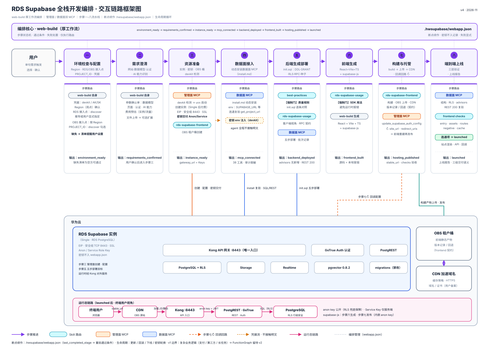

English | [中文](README.md)

# rds-supabase-web-build · RDS Supabase Full-Stack Development Orchestration Skill

Triggered by a single-sentence natural-language requirement (e.g., "create a website"), this skill has the AI Agent complete the entire pipeline from requirements to launch on RDS Supabase: requirement clarification and design, backend declarative configuration (DDL/GRANT/RLS/RPC) generation and deployment, frontend code generation, local test verification, fully managed OBS+CDN hosting, end-to-end launch acceptance, and lifecycle management (update/rollback/decommission/key rotation). This skill is a thick workflow orchestrator — a nine-step state machine with pass conditions, failure handling, and checkpoint resumption; the deep content of each stage is carried by six specialized skills, and this skill only routes, never duplicates content.

See [SKILL.md](SKILL.md) for execution logic.

## Overall Interaction Framework Diagram



Five bands from top to bottom: the orchestration bar (web-build + the webapp.json state machine) → the Step 1–9 pipeline → step routing cards (skills / dual MCPs) → the cloud resource foundation (RDS Supabase instance + OBS/CDN) → the end-user runtime path.

## Installation

Quick install (**with all companion skills - the seven skills under `skills/huaweicloud-supabase/` must be installed together in one pass, no skipping**):

```bash
npx skills add huaweicloud/rds-supabase-fullstack \
  --skill rds-supabase-web-build --skill rds-supabase-mgr-mcp --skill rds-supabase-mcp \
  --skill rds-supabase-usage --skill rds-supabase-frontend \
  --skill rds-supabase-postgres-best-practices --skill rds-supabase-function-graph \
  -a <agent> -y
```

(Node.js >= 22.20; see [INSTALL.md](INSTALL.md) for details)


See [INSTALL.md](INSTALL.md).

## MCP Installation Sources (used when the workflow installs them dynamically; the only allowed full URLs)

The two MCPs are absent at installation time; the skill's workflow installs them dynamically on demand (management plane → Step 3; data plane → Step 4). The commands below can be copied and used directly — no searching needed even if the repository has not been cloned locally. **Strict registration-location constraint**: after dynamic installation, an MCP may only be registered into the **current project's project-level MCP configuration** (Claude Code `.mcp.json`, CodeArts `.codeartsdoer/`, opencode `opencode.json`; all user-level and system-level locations are prohibited):

| MCP | Entry script | README (full URL) |
|---|---|---|
| Management plane (started at Step 3) | `mcp-server-huaweicloud-rds-supabase-mgr` | https://github.com/huaweicloud/rds-supabase-fullstack/blob/main/server/mcp_server_rds_supabase_mgr/README.md |
| Data plane (dynamically installed at Step 4) | `mcp-server-huaweicloud-rds-supabase` | https://github.com/huaweicloud/rds-supabase-fullstack/blob/main/server/mcp_server_rds_supabase/README.md |

```bash
# Management plane (started at Step 3)
uvx mcp-server-huaweicloud-rds-supabase-mgr
# Data plane (dynamically installed at Step 4, once instance credentials are ready)
uvx mcp-server-huaweicloud-rds-supabase
```

When the repository has been cloned locally, `uv run --directory server/<directory> <entry script>` is an equivalent alternative; PyPI installs can pin a version when needed (e.g. `uvx mcp-server-huaweicloud-rds-supabase-mgr@0.4.0`). **A missing `server/` subdirectory inside the skill directory is expected behavior** — the servers are not shipped in the skill package, and all in-repo path references should be resolved against the URLs in the table above; near-named third-party packages other than the two canonical names are prohibited.

## Value Comparison

For a value comparison of site-building modes (traditional self-built vs. fully managed; showcase material, not part of skill operation), see [showcase.md](showcase.md).

## License

MIT (see [LICENSE.txt](LICENSE.txt))
