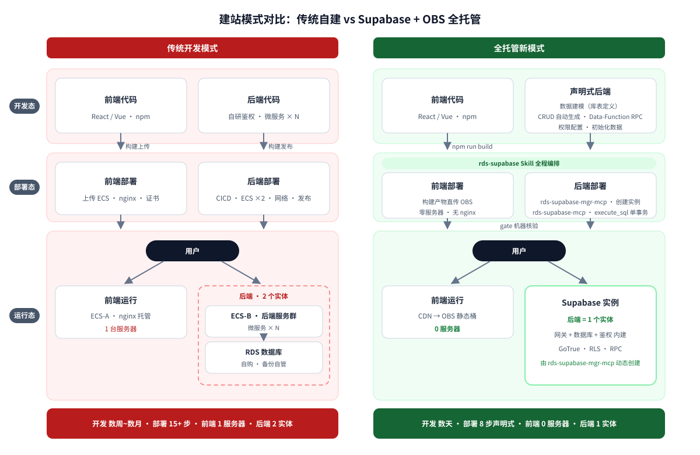

# 建站模式对比报告：传统自建 vs Supabase+OBS 全栈托管

> 面向读者：评估建站技术路线的决策者与开发者。本报告对比传统"前端→后端→数据库"自建链路，与本技能编排的全托管链路（RDS Supabase + OBS/CDN + FunctionGraph），说明各环节的职责转移、效率差与安全模型差异。

**一句话价值主张**：传统模式将工程精力消耗于系统运维（采购机器、搭建链路、维护服务）；全托管模式将建站收敛为**两个声明式产物——一份 init.sql 与一次前端构建上传**，其余全部由托管层与机器核验承接。

---

## 1. 架构与流程对比（左右对照）

*左列：前端、后端两条链路各自完成开发、部署、运行的全流程自建；右列：同一链路收敛为声明式产出与托管服务，工具对接如下——rds-supabase Skill 全程编排；**Supabase 实例由 rds-supabase-mgr-mcp 动态创建**；**init.sql 初始化配置由 rds-supabase-mcp 经 execute_sql 单事务部署**；前端构建产物直传 OBS；交付经 gate 机器核验。结论条直陈四项核心差异：开发周期、部署步骤、前端服务器数、后端实体数。*

---

## 2. 工作项映射：传统模式十项工作

| # | 传统模式工作项 | 全托管等价物 | 变化 |
|---|---|---|---|
| 1 | 后端应用开发（接口层/ORM/鉴权自研） | init.sql：表 + RPC + RLS——后端即数据层；复杂逻辑 → FunctionGraph | 开发量从"一个应用"降为"一份 SQL 声明" |
| 2 | CICD 流水线搭建与维护 | `execute_sql` 单事务五步部署；前端产物直传 OBS | **消除** |
| 3 | 微服务初步（拆分/注册中心/网关/追踪） | Postgres RPC（数据类逻辑）+ FunctionGraph（I/O 类逻辑）按需取用 | **消除**（v1 边界内） |
| 4 | ECS 购买/规格调优/OS 补丁/容量规划 | RDS Supabase 托管实例 | **云侧托管** |
| 5 | 网络配置（VPC/SLB/nginx/证书） | EIP + 安全组 8443 一次配置（管理面自动化），Kong 网关实例自带 | **自动化** |
| 6 | 后端部署与滚动发布 | init.sql 批次部署 + sha256 留痕（单命令） | 单命令化 |
| 7 | 前端 Node.js/nginx 部署 | OBS 静态托管 + CDN | **消除**（零服务器） |
| 8 | 鉴权体系自研（session/JWT/密码策略） | GoTrue：JWT 签发 + anon/service 双钥 + RLS | **内建** |
| 9 | 安全加固与自查 | RLS 声明式行级安全 + advisors 机器体检 + gate `--verify` 直连核验 | 内建 + 机器核验 |
| 10 | 扩容与峰值应对 | 托管服务弹性 + 函数天然弹性 | **云侧托管** |

---

## 3. 自行运维实体对比

| 需自行运维的实体 | 传统模式 | 全托管模式 |
|---|---|---|
| 服务器 / OS | ECS × 2+（前端托管 + 后端服务群）+ SLB | **0**（托管实例 + 对象存储） |
| 运行时（Node/JVM） | × N，随服务数增长 | **0** |
| CICD 流水线（Runner + 镜像仓库） | × 1 套，自建自养 | **0** |
| 反向代理（nginx） | × N | **0**（Kong 网关自带） |
| 鉴权服务 | × 1，自研自养 | **0**（GoTrue 内建） |

**说明**：右侧归零的每一行，均为传统模式中不产生业务价值的非差异化工作——采购、补丁、升级、证书轮换、容量预估——在新模式工程清单中全部消失。

---

## 4. 交付效率对比

| 维度 | 传统模式 | 全托管模式 |
|---|---|---|
| 触发方式 | 立项 → 架构评审 → 采购 → 搭建（人工编排） | **一句自然语言**（如"帮我建一个博客网站"） |
| 交付步骤 | 15+ 手工步骤（采购/初始化/搭建/部署/调优） | 8 个声明式步骤，断点续作 |
| 首站周期 | 数天~数周（受采购与搭建制约） | 小时级（实例创建 + 8 步流水线） |
| 过程感知 | 分散在各系统日志 | 进度看板全流程可视 + gate 逐断点核验 |
| 质量保障 | 依赖团队规范与评审 | best-practices 强制门 + SDK 契约门 + 机器验证 |

---

## 5. 安全模型对比

| 维度 | 传统模式 | 全托管模式 |
|---|---|---|
| 身份认证 | 自研（易出漏洞：密码策略/token 刷新/重置流程） | GoTrue 托管（JWT 签发/刷新/邮箱回路内建） |
| 前端持有凭据 | 视实现而定，常把高权凭据带进前端 | 分层设计：前端只持 anon 钥；service 钥**绝不进前端** |
| 行级数据隔离 | 应用层代码实现（逻辑分散、易漏） | RLS 声明式（数据层强制，策略即代码） |
| 安全自查 | 人工渗透测试与定期审计 | advisors 机器体检（性能/安全）持续扫描 |
| 上线验收 | 人工点检 | gate `--verify` **直连云核验**：对外表 anon 可见性、RLS 启用、advisors 零命中——不采信 agent 自报 |

---

## 6. 生命周期运维对比

| 操作 | 传统模式 | 全托管模式 |
|---|---|---|
| 后端更新 | 重新构建 → CICD → 滚动发布（停机窗口/灰度策略自管） | 新 init.sql 批次单事务部署，sha256 留痕可追溯 |
| 前端更新 | 重新构建 → 上传产物到 ECS → nginx 刷新 | 构建产物直传 OBS，重复发布快速路径（≤5 分钟量级） |
| 回滚 | 回滚镜像 + 数据库脚本（高风险，常需人工缝合） | init.sql 批次状态记录 / 前端版本三字段 + `rollback_verified`——**切换≠成功，重验收后才算** |
| 下线 | 多台 ECS/SLB/流水线/证书逐一清理（易残留） | `decommissioned` 单向清单（删触发器→删函数→清产物→删实例，两阶段确认） |
| 凭据轮换 | 自研轮换流程 | 项目级隔离存放（`.hwsupabase/secrets/`），轮换只影响本项目 |

---

## 7. 边界与适用性（诚实声明）

- **v1 后端边界为数据层**：纯数据变换/事务内一致性用 Postgres RPC；出站 HTTP、外部系统对接、交易通知、高安全隐私处理由 FunctionGraph 承载（`rds-supabase-function-graph` 技能）。
- **不支持 SSR / 长驻进程 / WebSocket 服务端**：前端为静态导出形态（继承 frontend 技能边界）。
- **极端定制化场景**（特殊运行时、私有协议、强依赖既有微服务资产）传统模式仍有其位置——本报告对比的是"从零建站并长期运维"这一主流场景下两者的总成本与风险面。

---

## 结论

传统模式的复杂度是**刚性且持续**的：链路上每一个自建组件均为长期负债（升级、补丁、故障面）。全托管模式的复杂度是**一次性且声明式**的：两个产物（init.sql 与前端构建产物）声明"目标状态"，托管层负责持续运行，gate 负责机器验证"确实达成"。建站成本由"运维一套完整系统"转变为"维护一份声明式配置"。
